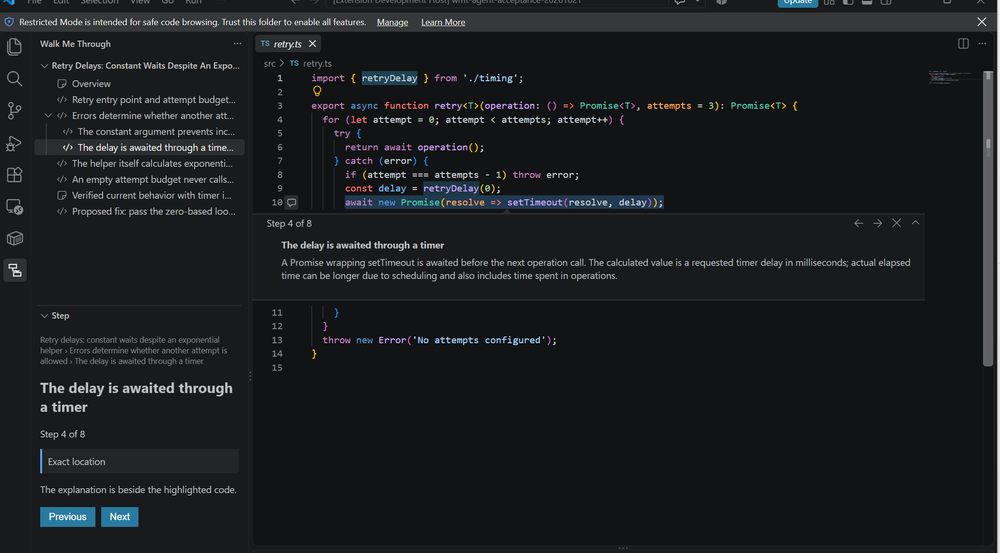

# Walk Me Through

> **“Moving the code context out of the model’s output and into the IDE, where it already exists.”**

## The problem

When a coding agent explores code or investigates a bug, its answer is usually a trail of references to small pieces of code across several files. Either you open every file, find each line, and piece the story together yourself, or the agent pastes large excerpts. Those excerpts cost tokens and repeat code you already have locally.

Walk Me Through gets that context from the agent to you **as quickly and with as little friction as possible**. The agent publishes a walkthrough, you click one link, and your IDE takes you through the explanation step by step, next to the highlighted code. You don't copy anything, search for lines, or reconstruct the connections.



## Try it

Requirements: Node 20+ for your agent, and desktop VS Code or Rider on a local desktop:

- **Windows** is tested by the maintainers.
- **Linux and macOS** are supported but not verified by the maintainers; automated CI runs the TypeScript side on both.
- **Not supported:** WSL, SSH sessions, containers, remote IDE hosts, and headless IDEs.

### Install the VS Code extension

Install **[Walk Me Through](https://marketplace.visualstudio.com/items?itemName=pvrobays.walk-me-through)** from the VS Code Marketplace. In VS Code, search for `walk-me-through` in the Extensions view, or run:

```sh
code --install-extension pvrobays.walk-me-through
```

Install it into the desktop VS Code that you normally start, so that it owns the `vscode://` link handler.

### Install the Rider plugin

1. Install **[Walk Me Through](https://plugins.jetbrains.com/plugin/35375-walk-me-through)** from JetBrains Marketplace: in Rider 2026.2 or later, open **Settings → Plugins → Marketplace**, search for `Walk Me Through`, install it and restart Rider.
2. Install **JetBrains Toolbox** if you don't have it. It handles `jetbrains://` links.

### Add the skill to your project and ask

In VS Code (Command Palette) or Rider (**Find Action**), run **Walk Me Through: Install Skill into Project**. It copies the skill that ships inside the extension or plugin into `.agents/skills/walk-me-through/` at your project's Git root. It needs no network, Node or clone. It only adds missing files: if a skill file already exists with different content, it changes nothing and names that file.

You may not need to run it yourself:

- When you open a Git project without the skill, the IDE offers to install it. **Install** installs it, **Not for This Project** stops the offer for that project, and **Don't Ask Again** stops it for every project in that IDE. These choices are stored in the IDE's own settings, never in your project.
- While the skill is missing, the Walk Me Through view shows a banner at its top, saying your AI agent can't create walkthroughs there, with an **Install Skill** button. The banner ignores those choices, so it is how you get back after dismissing the offer. There is no separate reset.

Commit `.agents/skills/walk-me-through/` so teammates get it too, then **restart OpenCode** in your project so it discovers the skill. Open the project in your IDE, then ask the agent to explain something that spans several files. Its reply starts with a link: click it, choose **Open in VS Code** or **Open in Rider**, and step through the walkthrough.

From a clone of this repository, `npm run skill:install -- <your-project-dir>` installs the same files; add `--force` to overwrite a customized copy.

### Development builds

To try unreleased changes, build the packages from this repository instead of installing from the stores:

```sh
npm install
npm run package:vsix
code --install-extension packages/vscode/walk-me-through-0.2.0.vsix
```

For Rider, build the ZIP as described in [Rider development](packages/rider/README.md#windows-build-sandbox-and-install). It is written to `packages/rider/build/distributions/`. In Rider, open **Settings → Plugins → gear → Install Plugin from Disk…**, select the ZIP, and restart Rider. Uninstall the store version first, or the two installs compete.

## Learn more

- [How it works](how-it-works.md): publishing, reading a walkthrough, changed code, links, and current limits.
- [IMPLEMENTATION.md](IMPLEMENTATION.md): design principles, MVP scope, roadmap, development setup, status, and related work.

## License

[MIT](LICENSE).
